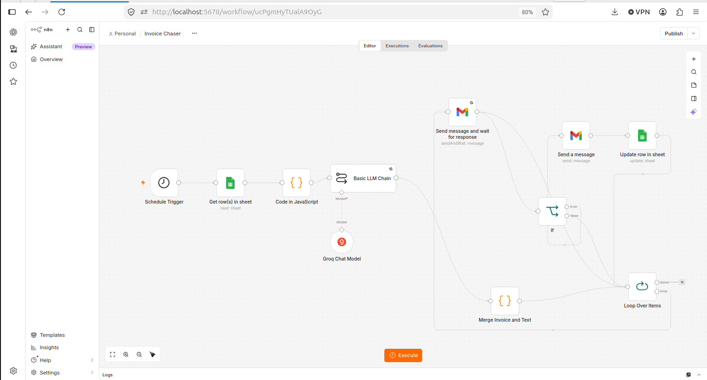
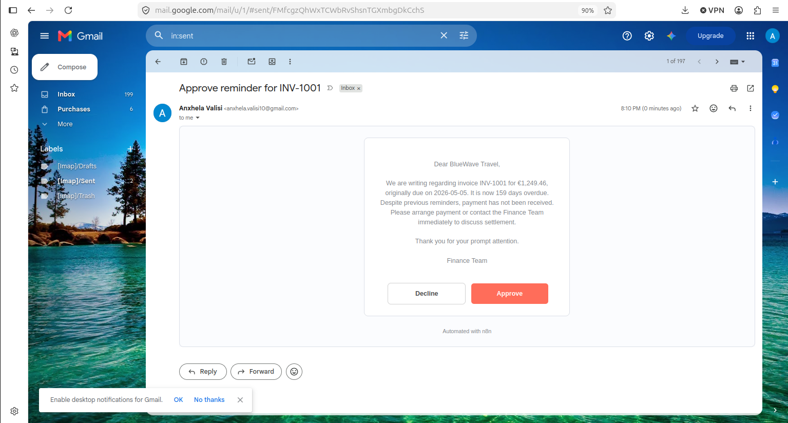

# Invoice Chaser: AI-drafted payment reminders with human approval (n8n)

An n8n workflow that finds overdue invoices, picks a reminder tone based on how late each one is, has an LLM draft the email, and **asks a human to approve it before anything is sent**.

> **Data note:** all data in this repo is **synthetic** (generated with Python, with a few planted edge cases for testing). No real clients or companies are involved.

## The problem

Chasing late payments is repetitive, easy to forget, and awkward to word. Fully automatic emails are risky: wrong tone, wrong amount, or a reminder sent twice. This project automates the routine part and keeps a person in control of what actually goes out.

## How it works

```
Schedule Trigger (daily, 08:00)
  -> Google Sheets: read "invoices" tab
  -> Code (JavaScript): select invoices that need a reminder, assign tone
  -> Basic LLM Chain (Groq): draft the email body
  -> Gmail: approval email for each invoice (Approve / Disapprove)
  -> If approved: reminder email is sent to the client
  -> Google Sheets: write last_reminder_date and reminder_count back to the invoice row
```

**Design choices**
- **Rules in code, wording in AI.** Which invoice gets a reminder, and at what tone, is decided by plain JavaScript. The LLM only writes the text, from facts it is given.
- **The model is told not to invent anything.** The prompt allows only the supplied facts and forbids legal threats, fees and made-up deadlines. I found the model adding a "further collection actions" threat in an early test, so I added explicit rules against it. This is why the approval step exists.
- **Workflow, not agent.** The steps are known in advance and involve money and clients, so a fixed, predictable workflow fits better than an autonomous agent.
- **Spam protection.** An invoice is skipped if it was reminded within the last 7 days.

### Tone rules

| Days overdue | Tone  |
|--------------|-------|
| 1 to 7       | soft  |
| 8 to 30      | firm  |
| over 30      | final |

Invoices that are Paid, not yet due, or reminded within 7 days are skipped.

## Test data

`data/finance_data.xlsx` has four tabs: `transactions`, `budget`, `invoices`, `settings`. This workflow uses `invoices` (21 rows). With the reference date 2026-10-11 it should select exactly these:

| Invoice  | Days overdue | Expected tone | Why                               |
|----------|--------------|---------------|-----------------------------------|
| INV-1018 | 6            | soft          |                                   |
| INV-1017 | 15           | firm          |                                   |
| INV-1015 | 33           | final         | 2 earlier reminders               |
| INV-1001 | 159          | final         | extreme case                      |

Skipped on purpose: INV-1016 (reminded 3 days ago) and INV-1019/1020/1021 (not yet due).

> Replace `YOUR_EMAIL@gmail.com` in the `client_email` column with your own address before testing, so no message reaches a real person.

## Setup

1. Import `data/finance_data.xlsx` into Google Sheets (File, Import, "Create new spreadsheet").
2. Run n8n locally (`npx n8n`) and open `http://localhost:5678`.
3. Import `workflow/invoice-chaser.json` and create your own credentials:
   - Google Sheets and Gmail via OAuth2 (Google Cloud project, enable the Sheets, Drive and Gmail APIs, add yourself as a test user)
   - Groq API key for the chat model
4. Point the Sheets node at your copy of the spreadsheet.
5. Run the workflow manually and check your inbox for the approval email.

The code node is in `code/filter_overdue_invoices.js` and the prompt in `prompts/reminder_prompt.txt`.

## Current status

**Working**
- Daily trigger, reading the sheet, filtering and tone selection (verified against the table above)
- Draft generation through Groq, with facts filled in from the data
- Approval email via Gmail with Approve / Disapprove, tested end to end with 4 invoices
- On approval, the reminder email is sent to the client
- After sending, `last_reminder_date` and `reminder_count` are written back to the sheet (checked on INV-1001: count 3 to 4, date updated), so the 7-day spam protection holds across runs
- The LLM node is configured to retry on failure (3 tries, 5 s between tries), so a busy AI service does not stop the run

## Notes and limitations

- There is no failure alert yet. If the workflow fails after the retries, nothing notifies the user (a separate n8n Error Trigger workflow would add this).
- Runs on local n8n, so it only works while n8n is running. Approval links point to `localhost`, so they must be opened on the same machine.
- n8n's Python code node was unavailable in the local setup (no task runner), so the logic is in JavaScript.
- Google OAuth runs in "Testing" mode, so access tokens may need re-authorising after about a week.
- The sample "today" date is fixed (`TODAY` in the code node) so results are reproducible. Set it to `null` for real use.

## Stack

n8n (self-hosted), Google Sheets, Gmail API, Groq (LLM), JavaScript.

## Screenshots



